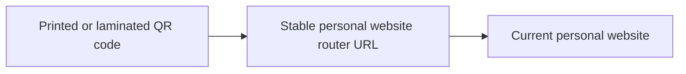

# Personal Website — QR Code Router

This repository provides a stable web address for QR codes that link to Joey Wilkes's personal website. Visitors scan a code, open the router, and are forwarded to the current website.

The router lets you **print, laminate, and distribute a QR code, then maintain its destination in one place.** If the website moves to another URL or hosting provider, update the router while keeping the address encoded in the QR code unchanged.

## Why use a router?

Printed materials can remain in circulation long after they are produced. A router separates those materials from the website's current location:

- **Preserve printed materials.** QR codes that point to the router can continue to work after a destination change, without reprinting or redistributing them.
- **Centralize updates.** One destination setting updates the redirect for every copy of the same QR code.
- **Support future moves.** The personal website can move between hosting providers while retaining a consistent entry point for visitors.

This depends on preserving the router URL and keeping its GitHub Pages publication available. The benefit applies to QR codes that encode the router address.

## Routing



| Address | URL |
| --- | --- |
| **Encode in the QR code** | [https://joeywilkes12.github.io/personal-website-router/](https://joeywilkes12.github.io/personal-website-router/) |
| Current destination website | [https://joey-wilkes-home.vercel.app/](https://joey-wilkes-home.vercel.app/) |

The router address stays the same when the destination changes. The destination website is maintained and hosted independently of this repository. The reusable [QR code PNG](personal-website-router-qr.png) is included here; preserve its white quiet zone when placing or printing it.

## Implementation

The router is a static HTML page with three paths to the same destination:

- A **meta refresh** forwards the browser to the destination.
- **JavaScript** uses `window.location.replace(...)` to navigate without adding the router page to browser history.
- A **manual link** lets visitors continue if automatic navigation does not occur.

The `redirect_url` setting in [index.html](index.html) supplies all three paths, the canonical link, and structured metadata. GitHub Pages processes the Liquid template through Jekyll so those references stay consistent.

No application backend or database is required. This is a browser redirect served with HTTP 200, rather than an HTTP 301 or 302 response.

## Deployment

GitHub Pages publishes this repository with the following configuration:

| Setting | Value |
| --- | --- |
| Publishing branch | `main` |
| Publishing folder | `/` (repository root) |
| Router source | [index.html](index.html) |
| Site configuration | [_config.yml](_config.yml) |
| Template processing | GitHub Pages Jekyll build |

Keep Jekyll enabled: adding `.nojekyll` or opening the source HTML directly skips the URL substitutions. Preview rendered content when validating changes. The README and maintenance documentation are excluded from the published site.

## Changing the destination

1. Confirm the replacement website is published and accessible at its new URL.
2. Create a branch from `main` and change only the `redirect_url` setting at the top of `index.html`, using an absolute HTTPS URL in double quotes:

   ```yaml
   redirect_url: "https://joey-wilkes-home.vercel.app/"
   ```

3. Update the current destination recorded in this README, render the page, and run the checks described in the [maintenance guide](MAINTENANCE.md).
4. Open a pull request against `main` for review and approval before merging.
5. After GitHub Pages finishes deploying, open the router URL and scan a printed QR code to verify that both reach the new website.

Keep the repository name, Pages address, and encoded QR URL unchanged. Existing printed and laminated copies can then continue directing visitors to the current website.

The [maintenance guide](MAINTENANCE.md) includes detailed preview, validation, recovery, and publication workflows. Use `redirect_url` in `index.html` as the source of truth for the configured destination.
